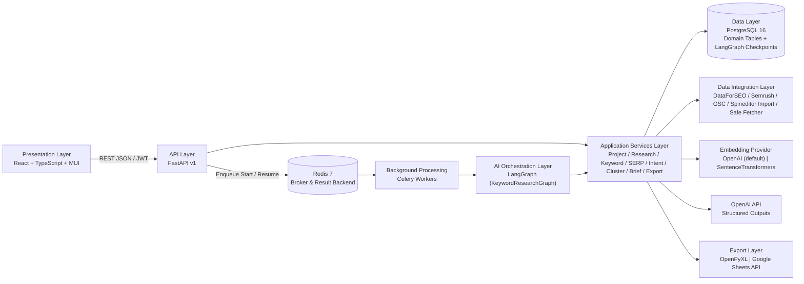

# ARCHITECTURE – AI Keyword Research & Content Planning Agent

## 1. Architecture Overview (Modular Monolith)

V1 uses a **Modular Monolith** architecture to ensure strong ACID transaction guarantees in PostgreSQL, streamlined development, straightforward debugging, and reliable end-to-end integration testing — while preserving clean internal module boundaries for future extraction if needed.

---

## 2. Layer Responsibilities

1. **Presentation Layer (`frontend/`)**:
   - React + TypeScript + Vite + **Material UI (MUI)** (`@mui/x-data-grid`).
   - Handles Project & Settings management, Research Run initiation, CSV/Excel file uploads (Semrush/Spineditor), workflow progress tracking, 3 Human-in-the-loop review screens, and report exports.
2. **API Layer (`backend/app/api/v1/`)**:
   - FastAPI routers, Pydantic v2 request/response validation, JWT authentication dependencies, and centralized exception handling.
   - Keeps business logic out of routes and never runs long-running data collection or LLM calls synchronously in HTTP requests.
3. **Application Layer (`backend/app/services/` & `backend/app/repositories/`)**:
   - Pure Python orchestration for each domain: `project_service`, `keyword_service`, `cleaning_service`, `clustering_service`, `intent_service`, `brief_service`, `export_service`.
   - Enforces the division of labor: **Python handles deterministic computation** (cleaning, deduplication, SERP overlap, weighted scoring, validation, export); **LLMs handle semantic analysis and synthesis** (intent reasoning, cluster naming/reasoning, content angle/brief generation).
4. **AI Orchestration Layer (`backend/app/agents/`)**:
   - `KeywordResearchGraph` built with **LangGraph** (15 nodes and 3 mandatory `interrupt()` gates: Review 1 Keywords, Review 2 Clusters, Review 3 Content Briefs).
   - Uses `langgraph-checkpoint-postgres` for durable state in PostgreSQL, keyed by `langgraph_thread_id`, ensuring workflows survive server/worker restarts.
5. **Data Integration Layer (`backend/app/connectors/`)**:
   - All external data sources implement the unified `BaseDataProvider` interface backed by `ResilientHttpClient` (rate limiting, timeouts, exponential backoff retries, quota tracking).
   - Includes `DataForSEO` (primary SERP + optional Keywords Data API), `Semrush` (API v4 + CSV/Excel Import), `Google Search Console` (OAuth 2.0 `webmasters.readonly`), `Spineditor` (CSV/Excel Import), and a `Safe Competitor HTML Fetcher` (H1–H3 extraction from Top 10 URLs).
6. **Data & Background Layer (`backend/app/database/`, `backend/app/workers/`)**:
   - PostgreSQL 16 (UUID, JSONB, `pg_trgm`, append-only history), accessed via synchronous SQLAlchemy 2.x (`psycopg3`) and the `get_db` dependency; schema managed by Alembic with an automated `migrate` service in Docker Compose.
   - Redis 7 + Celery Workers for asynchronous workflow execution.

---

## 3. Core Technical Designs

### 3.1. Sync HTTP vs. Async Workflow Execution
- `POST /research-runs/{id}/start` creates a `workflow_executions` record (`QUEUED`), dispatches a Celery task, and returns `202 Accepted` immediately.
- Celery runs `KeywordResearchGraph` until an `interrupt()` checkpoint (e.g. `REVIEW_1_KEYWORDS`), persists state to PostgreSQL, updates status (`WAITING_REVIEW_1`), and exits cleanly without blocking worker threads.
- When the user approves/edits in the UI and submits `review_decisions`, FastAPI dispatches `resume_research_run(thread_id)` to continue execution.

### 3.2. Pointer-Based LangGraph State
- Rather than storing thousands of keyword records and scraped HTML inside LangGraph checkpoint JSON, `ResearchGraphState` holds lightweight orchestration pointers and metadata (`research_run_id`, `project_id`, `current_stage`, `active_keyword_count`, `review_gate`, `node_metrics`, `errors`).
- Each node reads the latest approved domain records from PostgreSQL and writes results back to normalized tables.

### 3.3. `BaseEmbeddingProvider` Abstraction
- Clustering depends on `BaseEmbeddingProvider.embed_texts(texts: list[str]) -> list[list[float]]`.
- V1 defaults to **OpenAI `text-embedding-3-small`** (`EMBEDDING_PROVIDER=openai`) for lightweight Docker images and strong Vietnamese/English multilingual performance.
- Can switch to local **Sentence Transformers** (e.g. `intfloat/multilingual-e5-small`) via `EMBEDDING_PROVIDER=sentence_transformers` and installing `requirements-ml.txt`.

### 3.4. Data Provenance & Anti-Hallucination
- Every metric carries `source_id`, `collected_at`, `country_code`, `language_code`, `unit`, `raw_value`, `numeric_value`, and `data_status` (`AVAILABLE`, `NOT_AVAILABLE`, `NOT_COLLECTED`, `SOURCE_ERROR`, `NOT_APPLICABLE`).
- Missing metrics strictly store `numeric_value = NULL` (never substituted with `0`).
- All LLM outputs use OpenAI Structured Outputs (Pydantic schemas) paired with deterministic Python validators confirming that every referenced keyword and competitor URL exists in the current `research_run_id` (with bounded retries, max 2).

### 3.5. Security & Reliability Guardrails
- **Auth & Token Encryption**: JWT Auth (email/password) via `app/utils/security.py`, `app/api/deps.py` (`get_current_user`, `get_current_active_admin`), and `/api/v1/auth/{register,login,me}` protects all domain APIs; Google OAuth tokens (GSC, Google Sheets) are symmetrically encrypted with **Fernet** (`TokenEncryptor`) before storage.
- **Prompt Injection Defense**: Competitor titles, snippets, and H1–H3 headings are treated as **untrusted data** — sanitized, length-capped, and wrapped inside `<untrusted_serp_data>` delimiters in the `user` message (never in `system` instructions).
- **SSRF Protection**: The Competitor Heading Fetcher only accepts URLs persisted in `serp_results`, permits `http`/`https` only, resolves DNS before connecting, rejects private/loopback/link-local/metadata IP ranges (`127.0.0.0/8`, `10.0.0.0/8`, `172.16.0.0/12`, `192.168.0.0/16`, `169.254.0.0/16`, `::1`, etc.) across every redirect hop, enforces a 10s timeout and a 2MB response cap.

---

## 4. Ops & Observability (`TASK-002`)

- **Configuration & Production Guard (`app/config.py`)**: Pydantic `Settings` loads `.env`, protects secrets with `SecretStr`, parses `CORS_ORIGINS` (`NoDecode`), and blocks startup if `APP_ENV=production` has `APP_DEBUG=true` or placeholder `JWT_SECRET_KEY` / `OAUTH_TOKEN_ENCRYPTION_KEY`.
- **Structured Logging & Redaction (`app/utils/logging.py`)**: Unifies `structlog` and stdlib logging (`uvicorn`, `celery`) into one formatter (Console in `development`/`test`, JSON in `staging`/`production`), recursively redacting keys matching `password`, `secret`, `token`, `api_key`, `authorization`.
- **Request Tracing & Error Envelope (`app/api/middleware.py`, `app/api/errors.py`)**: `RequestContextMiddleware` validates or generates `X-Request-ID`, binds it to `structlog` contextvars, and echoes it in response headers; all `422`, `HTTPException`, and `500` errors return a uniform JSON error envelope with `request_id` (never leaking stack traces).
- **Operational Endpoints (`app/api/health.py`, `app/services/health_service.py`)**:
  - `GET /health`: Pure process liveness check with zero external I/O.
  - `GET /ready`: Real readiness check against PostgreSQL (`SELECT 1` via `psycopg`) and Redis (`PING`), returning `200` when ready or `503` on failure (reporting only exception class names to prevent DSN/credential leaks).
- **Celery Worker (`app/workers/celery_app.py`)**: Configured with JSON serialization, UTC timezone, `task_acks_late=True`, `worker_prefetch_multiplier=1`, 1800s time limit, and diagnostic task `system.ping`.
