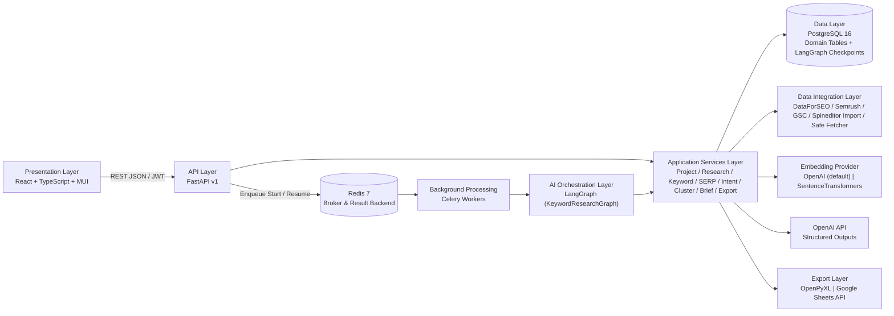

# ARCHITECTURE – AI Keyword Research & Content Planning Agent

## 1. Tổng quan kiến trúc (Modular Monolith)

Hệ thống V1 sử dụng kiến trúc **Modular Monolith** nhằm tối ưu tính toàn vẹn dữ liệu (ACID transactions trên PostgreSQL), tốc độ phát triển, khả năng debug và kiểm thử tích hợp end-to-end, đồng thời giữ ranh giới module sạch để có thể tách thành services độc lập nếu cần mở rộng về sau.

---

## 2. Trách nhiệm các tầng (Layers)

1. **Presentation Layer (`frontend/`)**:
   - React + TypeScript + Vite + **Material UI (MUI)** (`@mui/x-data-grid`).
   - Quản lý Project & Settings, khởi tạo Research Run, upload file import (Semrush/Spineditor), theo dõi tiến độ workflow, thực hiện 3 vòng kiểm duyệt Human-in-the-loop và xuất báo cáo.
2. **API Layer (`backend/app/api/v1/`)**:
   - FastAPI routers, Pydantic v2 request/response validation, JWT Authentication dependency, exception handlers tập trung.
   - Không chứa business logic phức tạp và không chạy tác vụ thu thập/LLM nặng trực tiếp trong HTTP request.
3. **Application Layer (`backend/app/services/` & `backend/app/repositories/`)**:
   - Điều phối nghiệp vụ thuần túy bằng Python cho từng miền: `keyword_service`, `cleaning_service`, `clustering_service`, `intent_service`, `brief_service`, `export_service`.
   - Đảm bảo nguyên tắc: **Python tính toán chính xác** (cleaning, deduplication, SERP overlap, scoring, validation, export); **LLM phân tích ngữ nghĩa & tổng hợp** (intent reasoning, cluster naming/reasoning, content angle/brief).
4. **AI Orchestration Layer (`backend/app/agents/`)**:
   - `KeywordResearchGraph` xây dựng trên **LangGraph** với 15 nodes và 3 điểm `interrupt()` bắt buộc (Review 1: Keywords, Review 2: Clusters, Review 3: Content Briefs).
   - Dùng `langgraph-checkpoint-postgres` lưu state bền vững trong PostgreSQL, gắn `langgraph_thread_id` để khôi phục chính xác sau khi server/worker restart.
5. **Data Integration Layer (`backend/app/connectors/`)**:
   - Tất cả nguồn dữ liệu triển khai interface thống nhất `BaseDataProvider`.
   - Gồm: `DataForSEO` (SERP chính + tùy chọn Keywords Data API), `Semrush` (API v4 + CSV/Excel Import), `Google Search Console` (OAuth 2.0 `webmasters.readonly`), `Spineditor` (CSV/Excel Import), và `Safe Competitor HTML Fetcher` (trích xuất H1–H3 từ Top 10 URLs).
6. **Data & Background Layer (`backend/app/database/`, `backend/app/workers/`)**:
   - PostgreSQL 16 (UUID, JSONB, `pg_trgm`, append-only history), truy cập qua synchronous SQLAlchemy 2.x (`psycopg3`) và dependency `get_db`; schema quản lý qua Alembic và service `migrate` chạy tự động trước `backend`/`worker` trong Docker Compose.
   - Redis 7 + Celery Workers thực thi workflow bất đồng bộ.

---

## 3. Các thiết kế kỹ thuật trọng tâm

### 3.1. Tách Sync HTTP và Async Workflow Execution
- Request `POST /research-runs/{id}/start` chỉ tạo `workflow_executions` ở trạng thái `QUEUED`, đẩy task sang Celery và trả về ngay HTTP `202 Accepted`.
- Celery worker chạy LangGraph từ node đầu tiên cho tới khi chạm điểm `interrupt()` (ví dụ `REVIEW_1_KEYWORDS`), cập nhật trạng thái `WAITING_REVIEW_1` và kết thúc task gọn gàng (không giữ worker thread bị block chờ con người).
- Khi người dùng duyệt trên UI và gọi `POST /research-runs/{id}/reviews`, API lưu `review_decisions` và đẩy Celery task `resume_research_run(thread_id)` chạy tiếp chặng kế tiếp.

### 3.2. Pointer-Based LangGraph State
- Thay vì nhét hàng nghìn keyword objects và HTML đối thủ vào LangGraph state (gây phình checkpoint và khó đồng bộ khi người dùng chỉnh sửa trên UI), `ResearchGraphState` chỉ lưu **con trỏ và metadata điều phối**: `research_run_id`, `project_id`, `current_stage`, `active_keyword_count`, `review_gate`, `node_metrics`, `errors`.
- Mọi node đọc dữ liệu mới nhất (đã qua human review) từ PostgreSQL và ghi kết quả trực tiếp xuống các bảng domain.

### 3.3. Trừu tượng hóa `BaseEmbeddingProvider`
- Module clustering sử dụng `BaseEmbeddingProvider.embed_texts(texts: list[str]) -> list[list[float]]`.
- V1 mặc định dùng **OpenAI `text-embedding-3-small`** (`EMBEDDING_PROVIDER=openai`) để giữ Docker nhẹ và hỗ trợ tốt song ngữ Việt/Anh.
- Có thể chuyển sang **Sentence Transformers local** (ví dụ `intfloat/multilingual-e5-small`) chỉ bằng cấu hình `EMBEDDING_PROVIDER=sentence_transformers` và cài `requirements-ml.txt`.

### 3.4. Data Provenance & Anti-Hallucination
- Mỗi metric đi kèm `source_id`, `collected_at`, `country_code`, `language_code`, `unit`, `raw_value`, `numeric_value`, và `data_status` (`AVAILABLE`, `NOT_AVAILABLE`, `NOT_COLLECTED`, `SOURCE_ERROR`, `NOT_APPLICABLE`).
- Khi nguồn không trả dữ liệu, `numeric_value = NULL` (tuyệt đối không điền `0`).
- Mọi kết quả AI dùng OpenAI Structured Outputs (Pydantic schema) kết hợp tầng Python Validator kiểm tra:
  - Toàn bộ keyword tham chiếu tồn tại trong `research_run_id`.
  - Toàn bộ competitor URLs trong evidence tồn tại trong `serp_results` của run đó.
  - Lưu `model_version` và `prompt_version`; nếu output không hợp lệ sẽ bounded retry (tối đa 2 lần) trước khi gắn cờ lỗi.

### 3.5. Security & Reliability Guardrails
- **Auth & Token Encryption**: JWT Auth (email/password) qua `app/utils/security.py`, `app/api/deps.py` (`get_current_user`, `get_current_active_admin`) và `/api/v1/auth/{register,login,me}` bảo vệ mọi API domain; OAuth tokens (GSC, Google Sheets) được mã hóa bằng **Fernet** (`TokenEncryptor`) trước khi lưu vào PostgreSQL.
- **Prompt Injection Defense**: Title, Snippet và Heading H1–H3 từ website đối thủ được xem là **untrusted data** — loại bỏ script/hidden text, cắt độ dài an toàn, và đặt trong khối delimiter `<untrusted_serp_data>` ở `user` message (không bao giờ đưa vào `system` prompt).
- **SSRF Protection**: Competitor Heading Fetcher chỉ nhận URL từ `serp_results` đã lưu, chỉ cho phép scheme `http`/`https`, resolve DNS trước khi kết nối và từ chối mọi dải IP nội bộ/loopback/link-local/metadata (`127.0.0.0/8`, `10.0.0.0/8`, `172.16.0.0/12`, `192.168.0.0/16`, `169.254.0.0/16`, `::1`, v.v.), kiểm tra lại IP ở mỗi bước redirect, timeout 10s, tối đa 2MB.

---

## 4. Ops & Observability (`TASK-002`)

- **Configuration & Production Guard (`app/config.py`)**: Dùng Pydantic `Settings` đọc từ `.env`, bọc secrets bằng `SecretStr`, parse `CORS_ORIGINS` (`NoDecode`), và chặn khởi động nếu `APP_ENV=production` vẫn bật `APP_DEBUG=true` hoặc dùng placeholder `JWT_SECRET_KEY` / `OAUTH_TOKEN_ENCRYPTION_KEY`.
- **Structured Logging & Redaction (`app/utils/logging.py`)**: Hợp nhất `structlog` và stdlib logging (`uvicorn`, `celery`) về một pipeline thống nhất (Console ở `development`/`test`, JSON ở `staging`/`production`), tự động mask mọi key chứa `password`, `secret`, `token`, `api_key`, `authorization`.
- **Request Tracing & Error Envelope (`app/api/middleware.py`, `app/api/errors.py`)**: `RequestContextMiddleware` đọc/validate `X-Request-ID` (hoặc sinh UUID4), gắn vào `structlog` contextvars và response header; mọi lỗi `422`, `HTTPException`, `500` trả chung JSON envelope kèm `request_id` (không lộ stack trace ra client).
- **Operational Endpoints (`app/api/health.py`, `app/services/health_service.py`)**:
  - `GET /health`: Liveness check thuần process, không gọi I/O ngoài.
  - `GET /ready`: Readiness check thực tế tới PostgreSQL (`SELECT 1` qua `psycopg`) và Redis (`PING`), trả `200` khi toàn bộ ok hoặc `503` khi có dependency lỗi (chỉ trả tên class ngoại lệ, không rò rỉ DSN/credentials).
- **Celery Worker (`app/workers/celery_app.py`)**: Cấu hình JSON serialization, UTC, `task_acks_late=True`, `worker_prefetch_multiplier=1`, timeout 1800s và task chẩn đoán `system.ping`.
