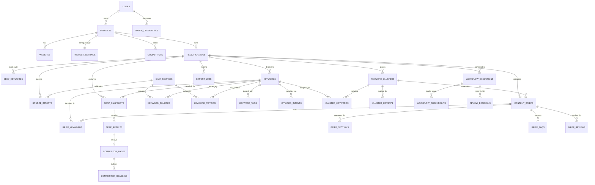

# DATABASE DESIGN – AI Keyword Research & Content Planning Agent

## 1. Core Design Conventions

1. **Primary Keys**: All domain tables use `UUID` (`uuid4` in Python + `gen_random_uuid()` in PostgreSQL).
2. **Timestamps**: All timestamp columns use `TIMESTAMPTZ` (stored in UTC).
3. **Data Provenance**: Every keyword metric stores `source_id`, `collected_at`, `country_code`, `language_code`, `unit`, `raw_value`, and `data_status` (`AVAILABLE`, `NOT_AVAILABLE`, `NOT_COLLECTED`, `SOURCE_ERROR`, `NOT_APPLICABLE`). Missing data is stored as `NULL`, never `0`.
4. **Append-only History**: `keyword_metrics` and `serp_snapshots` insert new rows per collection run rather than overwriting historical observations.
5. **Non-destructive Cleaning & Human-in-the-loop**:
   - Duplicate or irrelevant keywords are never hard-deleted; their `cleaning_status` transitions (`DUPLICATE`, `NEAR_DUPLICATE`, `IRRELEVANT`, `INVALID`) while preserving `original_keyword`.
   - Original AI outputs (`origin = 'AI'`) remain intact when edited by humans (`origin = 'HUMAN'` / versioned rows + `*_reviews` audit tables).

---

## 2. Entity Relationship Diagram (ERD)



---

## 3. Table Group Specifications

### Group 1: Auth & Project Management
- **`users`**: `id (UUID PK)`, `email (UNIQUE)`, `password_hash`, `full_name`, `role`, `is_active`, `created_at`, `updated_at`.
- **`oauth_credentials`**: `id (UUID PK)`, `user_id (FK -> users)`, `provider ('google_gsc' | 'google_sheets')`, `account_email`, `encrypted_access_token`, `encrypted_refresh_token`, `scopes (TEXT[])`, `expires_at`, `created_at`, `updated_at`.
- **`projects`**: `id (UUID PK)`, `owner_id (FK -> users)`, `name`, `niche`, `target_country (CHAR(2))`, `target_language (VARCHAR(10))`, `target_audience`, `status`, `created_at`, `updated_at`.
- **`websites`**: `id (UUID PK)`, `project_id (FK -> projects)`, `domain`, `base_url`, `gsc_property_uri (NULLABLE)`, `is_primary`, `created_at`, `updated_at`. Unique `(project_id, domain)`.
- **`project_settings`**: `id (UUID PK)`, `project_id (FK -> projects UNIQUE)`, `prioritization_weights (JSONB)`, `clustering_weights (JSONB)` (default `{"semantic": 0.3, "serp_overlap": 0.5, "intent": 0.2}`), `default_serp_provider`, `default_device`, `custom_rules (JSONB)`.
- **`competitors`**: `id (UUID PK)`, `project_id (FK -> projects)`, `domain`, `name`, `notes`, `created_at`, `updated_at`. Unique `(project_id, domain)`.

### Group 2: Keyword Research & Data Provenance
- **`data_sources`**: `id (UUID PK)`, `code (UNIQUE)`, `name`, `source_type ('API' | 'FILE_IMPORT' | 'MANUAL')`, `is_active`, `metadata (JSONB)`. Seeded defaults: `dataforseo_serp`, `dataforseo_kw`, `semrush_api`, `semrush_csv`, `gsc_api`, `spineditor_import`, `manual`.
- **`research_runs`**: `id (UUID PK)`, `project_id (FK -> projects)`, `name`, `search_context`, `country_code`, `language_code`, `device`, `status`, `config_snapshot (JSONB)`, `created_by (FK -> users)`, `created_at`, `completed_at`.
- **`seed_keywords`**: `id (UUID PK)`, `research_run_id (FK -> research_runs)`, `seed_text`, `topic`, `created_at`.
- **`keywords`**: `id (UUID PK)`, `research_run_id (FK -> research_runs)`, `original_keyword`, `normalized_keyword`, `language_code`, `keyword_type`, `cleaning_status ('RAW' | 'ACTIVE' | 'DUPLICATE' | 'NEAR_DUPLICATE' | 'IRRELEVANT' | 'INVALID')`, `duplicate_of_keyword_id (FK -> keywords NULLABLE)`, `review_status ('PENDING' | 'APPROVED' | 'REJECTED')`, `priority_score (NUMERIC NULLABLE)`, `priority_tier`, `priority_reasoning`, `is_manual_entry`, `created_at`, `updated_at`.
  - *Constraints & Indexes*: Partial unique index `(research_run_id, normalized_keyword) WHERE cleaning_status = 'ACTIVE'`; GIN trigram index (`pg_trgm`) on `normalized_keyword`; composite index `(research_run_id, review_status, cleaning_status)`.
- **`keyword_sources`**: `id (UUID PK)`, `keyword_id (FK -> keywords)`, `source_id (FK -> data_sources)`, `source_import_id (FK -> source_imports NULLABLE)`, `source_record_id (NULLABLE)`, `raw_keyword`, `discovered_at`.
- **`keyword_metrics`**: `id (UUID PK)`, `keyword_id (FK -> keywords)`, `source_id (FK -> data_sources)`, `metric_type`, `numeric_value (NUMERIC NULLABLE)`, `raw_value`, `unit`, `currency (NULLABLE)`, `country_code`, `language_code`, `data_status`, `collected_at`, `extra_metadata (JSONB)`.
  - *Index*: `(keyword_id, metric_type, collected_at DESC)`.
- **`keyword_tags`**: `id (UUID PK)`, `keyword_id (FK -> keywords)`, `tag_name`, `tag_source ('AI' | 'RULE' | 'USER')`.

### Group 3: SERP & Competitor Analysis
- **`serp_snapshots`**: `id (UUID PK)`, `research_run_id (FK -> research_runs)`, `keyword_id (FK -> keywords)`, `provider_code`, `query_text`, `country_code`, `language_code`, `location_name`, `device`, `serp_features (JSONB)`, `raw_response_metadata (JSONB)`, `data_status`, `collected_at`.
  - *Index*: `(research_run_id, keyword_id, collected_at DESC)`.
- **`serp_results`**: `id (UUID PK)`, `serp_snapshot_id (FK -> serp_snapshots)`, `position`, `url`, `normalized_url`, `domain`, `title`, `snippet`, `result_type`, `competitor_page_id (FK -> competitor_pages NULLABLE)`.
  - *Indexes*: `(serp_snapshot_id, position)` and `(normalized_url)` for fast SERP Overlap calculation.
- **`competitor_pages`**: `id (UUID PK)`, `normalized_url (UNIQUE)`, `url`, `domain`, `http_status`, `fetch_status`, `page_title`, `meta_description`, `content_type_inferred`, `word_count_estimate (INT NULLABLE)`, `fetched_at`.
- **`competitor_headings`**: `id (UUID PK)`, `competitor_page_id (FK -> competitor_pages)`, `level (SMALLINT CHECK 1..6)`, `heading_text`, `position_order`.

### Group 4: Search Intent & Keyword Clustering
- **`keyword_intents`**: `id (UUID PK)`, `keyword_id (FK -> keywords)`, `serp_snapshot_id (FK -> serp_snapshots NULLABLE)`, `primary_intent`, `secondary_intent (NULLABLE)`, `confidence (NUMERIC(4,3))`, `reasoning`, `evidence (JSONB)`, `model_version`, `prompt_version`, `origin ('AI' | 'HUMAN')`, `is_current (BOOLEAN)`, `created_at`.
- **`keyword_clusters`**: `id (UUID PK)`, `research_run_id (FK -> research_runs)`, `cluster_name`, `primary_keyword_id (FK -> keywords NULLABLE)`, `cluster_intent`, `confidence (NUMERIC(4,3))`, `clustering_reasoning`, `scoring_breakdown (JSONB)`, `status`, `origin ('AI' | 'HUMAN')`, `version (INT)`, `created_at`, `updated_at`.
- **`cluster_keywords`**: `id (UUID PK)`, `cluster_id (FK -> keyword_clusters)`, `keyword_id (FK -> keywords)`, `role ('PRIMARY' | 'SECONDARY' | 'SUPPORTING')`, `similarity_score`, `serp_overlap_score`, `semantic_score`, `intent_score`, `is_manual_override (BOOLEAN)`.
- **`cluster_reviews`**: `id (UUID PK)`, `cluster_id (FK -> keyword_clusters)`, `action`, `before_snapshot (JSONB)`, `after_snapshot (JSONB)`, `reviewer_id (FK -> users)`, `notes`, `created_at`.

### Group 5: Content Planning (Content Brief)
- **`content_briefs`**: `id (UUID PK)`, `research_run_id (FK -> research_runs)`, `cluster_id (FK -> keyword_clusters)`, `primary_keyword_id (FK -> keywords)`, `version (INT)`, `is_current (BOOLEAN)`, `origin ('AI' | 'HUMAN')`, `status`, `search_intent`, `target_audience`, `content_objective`, `content_angle`, `suggested_seo_title`, `meta_description`, `h1`, `competitor_insights (JSONB)`, `important_topics (JSONB)`, `content_recommendations (JSONB)`, `keyword_coverage (JSONB)`, `evidence_refs (JSONB)`, `model_version`, `prompt_version`, `created_at`, `updated_at`.
- **`brief_keywords`**: `id (UUID PK)`, `content_brief_id (FK -> content_briefs)`, `keyword_id (FK -> keywords)`, `usage_role`, `placement_hint (NULLABLE)`.
- **`brief_sections`**: `id (UUID PK)`, `content_brief_id (FK -> content_briefs)`, `parent_section_id (FK -> brief_sections NULLABLE)`, `heading_level (SMALLINT CHECK IN (2, 3))`, `heading_text`, `section_order`, `key_points (JSONB)`, `target_keywords (JSONB)`.
- **`brief_faqs`**: `id (UUID PK)`, `content_brief_id (FK -> content_briefs)`, `question`, `answer_guidance`, `source_evidence`, `display_order`.
- **`brief_reviews`**: `id (UUID PK)`, `content_brief_id (FK -> content_briefs)`, `action`, `before_snapshot (JSONB)`, `after_snapshot (JSONB)`, `reviewer_id (FK -> users)`, `feedback_notes`, `created_at`.

### Group 6: Workflow, Imports & Exports
- **`source_imports`**: `id (UUID PK)`, `research_run_id (FK -> research_runs)`, `source_id (FK -> data_sources)`, `file_name`, `file_hash_sha256`, `column_mapping (JSONB)`, `total_rows`, `imported_rows`, `error_rows`, `error_details (JSONB)`, `status`, `created_by (FK -> users)`, `created_at`.
- **`workflow_executions`**: `id (UUID PK)`, `research_run_id (FK -> research_runs)`, `langgraph_thread_id (UNIQUE)`, `celery_task_id`, `current_node`, `status`, `error_message`, `started_at`, `updated_at`, `completed_at`.
- **`workflow_checkpoints`**: `id (UUID PK)`, `workflow_execution_id (FK -> workflow_executions)`, `node_name`, `checkpoint_key`, `status`, `metrics_summary (JSONB)`, `created_at`. *(Alongside internal tables managed by `langgraph-checkpoint-postgres`).*
- **`review_decisions`**: `id (UUID PK)`, `workflow_execution_id (FK -> workflow_executions)`, `review_gate`, `decision`, `summary_diff (JSONB)`, `reviewer_id (FK -> users)`, `comment`, `decided_at`.
- **`export_jobs`**: `id (UUID PK)`, `research_run_id (FK -> research_runs)`, `export_type ('EXCEL' | 'GOOGLE_SHEETS')`, `status`, `file_path`, `google_spreadsheet_id`, `google_spreadsheet_url`, `error_message`, `created_by (FK -> users)`, `created_at`, `completed_at`.

---

## 4. Alembic Migration Plan

1. `001_init_core_and_projects`: `pg_trgm` extension, `users`, `oauth_credentials`, `projects`, `websites`, `project_settings`, `competitors`, `data_sources` (+ seed).
2. `002_keyword_research_and_imports`: `research_runs`, `seed_keywords`, `source_imports`, `keywords`, `keyword_sources`, `keyword_metrics`, `keyword_tags`.
3. `003_serp_and_intent`: `serp_snapshots`, `serp_results`, `competitor_pages`, `competitor_headings`, `keyword_intents`.
4. `004_clustering_and_reviews`: `keyword_clusters`, `cluster_keywords`, `cluster_reviews`.
5. `005_workflow_and_hitl`: `workflow_executions`, `workflow_checkpoints`, `review_decisions`.
6. `006_content_briefs_and_exports`: `content_briefs`, `brief_keywords`, `brief_sections`, `brief_faqs`, `brief_reviews`, `export_jobs`.

---

## 5. Migration 001 Implementation Status (`TASK-003`)

### Technical Decisions
- **Synchronous SQLAlchemy 2.x + `psycopg3`**: Aligns cleanly with Celery workers, `langgraph-checkpoint-postgres`, and FastAPI `def` endpoints running in threadpool.
- **`VARCHAR` + `CHECK` constraints instead of native PostgreSQL `ENUM`**: Allows adding or adjusting allowed values in future migrations without complex `ALTER TYPE` locks.
- **Unified Naming Convention on `Base.metadata`**: `ix_`, `uq_`, `ck_`, `fk_`, `pk_` ensure deterministic constraint names and clean `alembic check` verification.
- **`ON DELETE` Policies**:
  - `oauth_credentials.user_id` → `CASCADE`
  - `websites.project_id`, `project_settings.project_id`, `competitors.project_id` → `CASCADE`
  - `projects.owner_id` → `RESTRICT` (prevents accidental deletion of users who own research projects).

### Implemented Constraints & Seed Data (`0001_init_core`)
- Extension: `pg_trgm`.
- Check constraints: `ck_users_role_allowed`, `ck_data_sources_source_type_allowed`, `ck_oauth_credentials_provider_allowed`, `ck_projects_target_country_iso2`, `ck_projects_target_language_bcp47`, `ck_projects_status_allowed`, `ck_project_settings_default_device_allowed`.
- Partial unique index: `uq_websites_one_primary_per_project` on `websites(project_id) WHERE is_primary`.
- Seeded `data_sources`: `dataforseo_serp`, `dataforseo_kw`, `semrush_api`, `semrush_csv`, `gsc_api`, `spineditor_import`, `manual`.

### Common Alembic Commands
```powershell
# Run migrations inside Docker
docker compose run --rm migrate alembic upgrade head
docker compose run --rm migrate alembic check

# Generate and apply a new migration locally
Set-Location backend
.\.venv\Scripts\python.exe -m alembic revision --autogenerate -m "describe_change"
.\.venv\Scripts\python.exe -m alembic upgrade head
.\.venv\Scripts\python.exe -m alembic downgrade base
```
